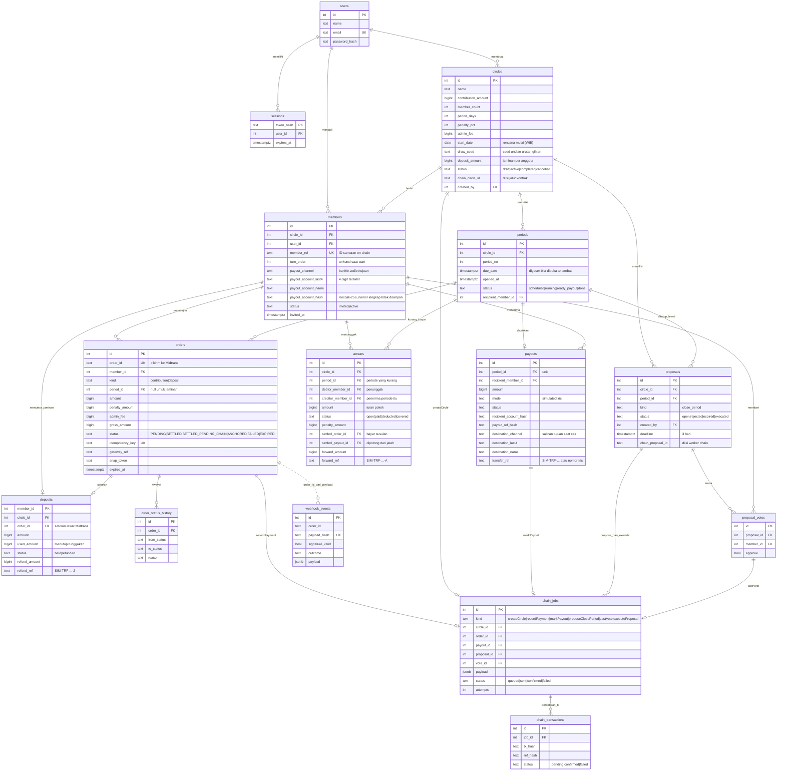

# ERD — LingkarPay (jalur payment gateway)

Sumber kebenaran: `apps/api/db/migrations/` (001, 002, 003). Diagram Mermaid (dapat dirender di GitHub).

## Aturan integritas penting
- `orders.gross_amount = amount + penalty_amount + admin_fee` (CHECK).
- Satu iuran aktif per anggota per periode: indeks unik parsial pada `orders (member_id, period_id)` untuk status PENDING/SETTLED/SETTLED_PENDING_CHAIN/ANCHORED. Order FAILED/EXPIRED boleh digantikan.
- Satu job per kelompok, order, dan payout: indeks unik parsial `chain_jobs (kind, circle_id)`, `(kind, order_id)`, dan `(kind, payout_id)`.
- Uang selalu BIGINT rupiah.
- `circles.start_date`: kelompok baru bisa dikunci pada/sesudah tanggal ini. `circles.draw_seed`: urutan giliran = anggota diurutkan menurut SHA-256(seed:member_ref) (migrasi 007).
- Data on-chain hanya `member_ref` dan hash (tanpa nama, email, atau nomor rekening).
- Satu usulan terbuka per periode: indeks unik parsial `proposals (period_id) WHERE status = 'open'`. Satu suara per anggota per usulan: `UNIQUE (proposal_id, member_id)`.
- Satu job per usulan dan per suara: indeks unik parsial `chain_jobs (kind, proposal_id)` dan `(kind, vote_id)`. Bentuk baris `chain_jobs` dijaga CHECK menurut `kind`.
