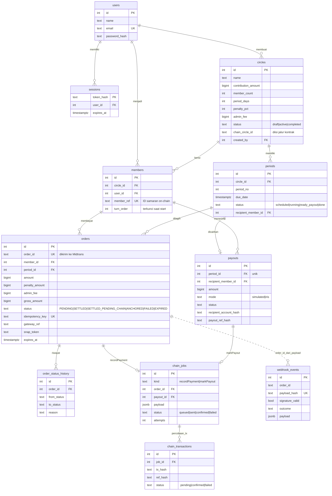

# ERD — LingkarPay (jalur payment gateway)

Sumber kebenaran: `apps/api/db/migrations/001_init.sql`. Diagram Mermaid (dapat dirender di GitHub).

## Aturan integritas penting
- `orders.gross_amount = amount + penalty_amount + admin_fee` (CHECK).
- Satu iuran aktif per anggota per periode: indeks unik parsial pada `orders (member_id, period_id)` untuk status PENDING/SETTLED/SETTLED_PENDING_CHAIN/ANCHORED. Order FAILED/EXPIRED boleh digantikan.
- Satu job per order dan per payout: indeks unik parsial `chain_jobs (kind, order_id)` dan `(kind, payout_id)`.
- Uang selalu BIGINT rupiah.
- Data on-chain hanya `member_ref` dan hash (tanpa nama, email, atau nomor rekening).
